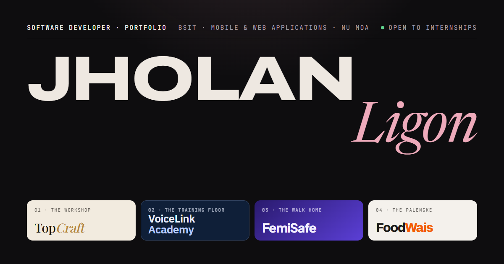

# Jholan Ligon · Developer Portfolio



The personal portfolio of **Jholan Ligon**, a fourth-year BS Information Technology student at
National University – Mall of Asia, specialising in Mobile and Web Applications, and open to
software development internships.

The site is called **Four Rooms**. Each project is shown in the real place it was built for, and
each room takes on that product's own colours and typography. Around the rooms, the site is a
calm, dark gallery.

## Projects

| Room | Project | What it is | Type |
|---|---|---|---|
| The Workshop | **TopCraft** | A furniture manufacturing management system for Industrial Manila Furniture: an owner web platform plus an Android app for clients and workers | Client-based capstone |
| The Training Floor | **VoiceLink Academy** | A call-center training LMS with Agent, Trainer and Admin portals, server-timed quizzes and a server-scored call simulator (React, Node.js, Express, MongoDB, JWT) | Course final project, team of three |
| The Walk Home | **FemiSafe** | An Android personal-safety app with SOS, journey check-ins, live location by SMS and a fake call. No account needed. | Independent project |
| The Palengke | **FoodWais** | A local-AI mobile concept for checking food freshness, tracking the pantry and comparing market prices | Hackathon project (AppBuildersPH, team CocoJJAM) |

Each project has its own case-study page at `/work/<slug>` covering the problem, the people it
serves, its features, design decisions, contribution and stack.

## Features

- **Per-project branding.** Each room and case study is themed in that product's own palette and
  typeface, through CSS custom properties.
- **Real media only.** Product films, app-store panels and unedited app captures. Nothing is
  mocked up.
- **Custom film player** with chapters, keyboard shortcuts (Space/K, J/L or arrow keys, M, F) and
  fullscreen. Films can also be watched in an overlay on the home page.
- **Image viewer** with full-resolution images, keyboard and swipe navigation, click to zoom,
  and focus returned to the image you opened.
- **Scroll storytelling.** FemiSafe pins a phone that changes screens as you read. FoodWais has a
  storyboard of real film frames that each play the film from that moment.
- **Page transitions.** A project's cover morphs into its case-study hero
  (cross-document View Transitions).
- **Accessible by default.** Semantic HTML, keyboard support throughout and WCAG AA contrast.
  All motion respects `prefers-reduced-motion`.
- **Fast.** Static HTML, about 10 KB of JavaScript per page and no UI framework. Responsive WebP
  images are generated at build time, and videos load only when played.
- **SEO ready.** Page metadata, Open Graph image, JSON-LD structured data and an optional sitemap.

## Tech stack

- [Astro 5](https://astro.build), static output
- TypeScript (strict)
- Plain CSS with design tokens, no CSS framework
- Astro content collections: project content is YAML, validated by a Zod schema
- `astro:assets` with sharp for image optimisation
- Self-hosted variable fonts via Fontsource: Archivo, Newsreader, JetBrains Mono, plus each
  product's brand font

## Getting started

Requires **Node.js 20** or newer.

```sh
git clone https://github.com/JholanL/jholan-ligon-portfolio.git
cd jholan-ligon-portfolio
npm install
npm run dev
```

Then open <http://localhost:4321>.

| Command | What it does |
|---|---|
| `npm run dev` | Start the dev server with hot reload |
| `npm run build` | Type-check with `astro check`, then build the static site into `dist/` |
| `npm run preview` | Serve the production build locally |
| `npm run check` | Type-check only |
| `npm run media` | Copy and derive media from a local `Portfolio-Assets/` archive (see below) |

## Project structure

```text
src/
  content/projects/   one YAML file per project (text, facts, theme, media, page sections)
  content.config.ts   schema that validates every project file
  data/profile.ts     name, school, contact links, toolkit, timeline
  components/home/    home page: masthead, room index, one room per project, about, contact
  components/case/    case-study hero and section blocks
  components/         shared media pieces: image, film player, lightbox, gallery rail
  scripts/            small browser scripts (film, lightbox, tabs, reveals, transitions)
  styles/global.css   design tokens, typography, layout utilities
  assets/             images, optimised at build time
public/
  media/              project films and muted preview loops
scripts/import-media.mjs
```

## Editing content

- **Personal details and links:** `src/data/profile.ts`. Empty fields (email, LinkedIn, résumé)
  are hidden on the site until you fill them in.
- **A project:** `src/content/projects/<slug>.yaml`. Its `sections` list chooses the blocks on the
  case-study page and their order. The available blocks are `brief`, `film`, `features`,
  `gallery`, `tabs`, `pipeline`, `roles`, `scenes`, `storyboard`, `architecture`, `decisions`,
  `engineering`, `quote`, `note`, `contribution` and `stack`.
- **Images:** `src/assets/projects/<slug>/`. **Videos:** `public/media/<slug>/` (H.264/AAC MP4).

The build fails on a missing image or a malformed YAML value, so broken content can't be deployed
silently.

### Media pipeline

The original media archive (`Portfolio-Assets/`) is kept out of the repository. `npm run media`
copies the curated files from it into the site and uses ffmpeg to derive posters, preview loops
and film stills (set `FFMPEG` to your ffmpeg path). It never modifies the archive, and it skips
existing files unless run with `-- --force`.

## Deployment

The build output in `dist/` is a plain static site:

- **Vercel, Netlify or Cloudflare Pages:** build command `npm run build`, output directory `dist`.
- Set the environment variable `SITE_URL` (for example `https://your-domain.dev`) to enable
  canonical URLs, absolute social-preview links and `sitemap-index.xml`.

## Contact

- GitHub: [@JholanL](https://github.com/JholanL)

---

© Jholan Ligon. The code, writing and project media in this repository are all rights reserved
unless a license is added.
